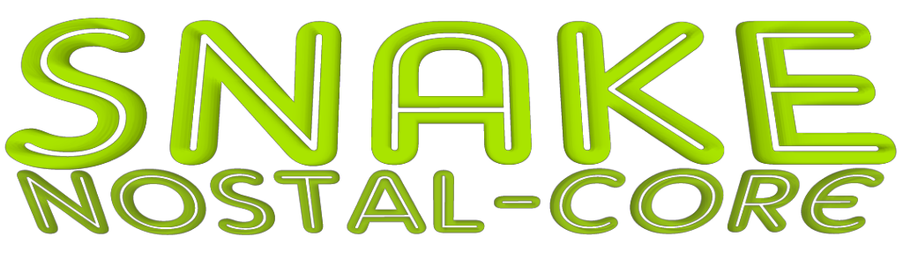
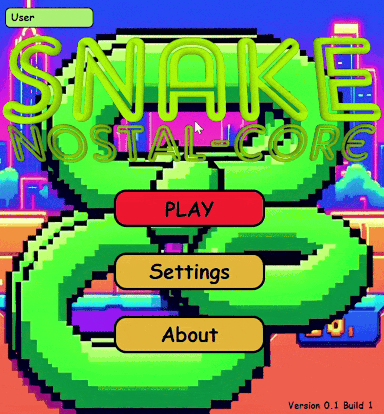
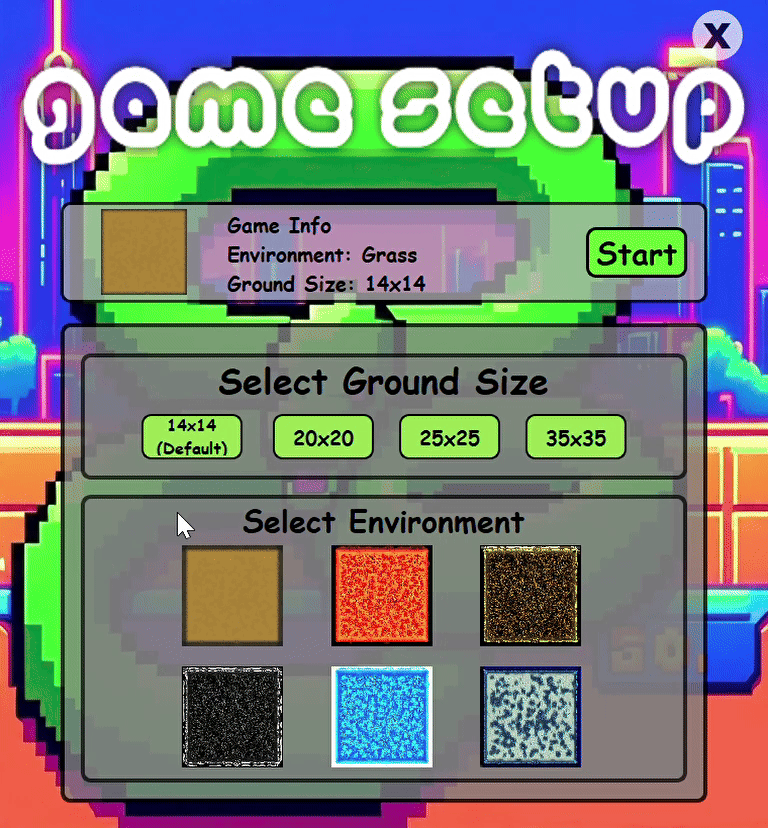
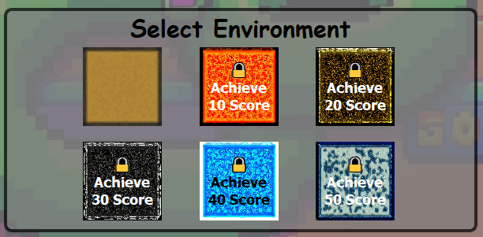
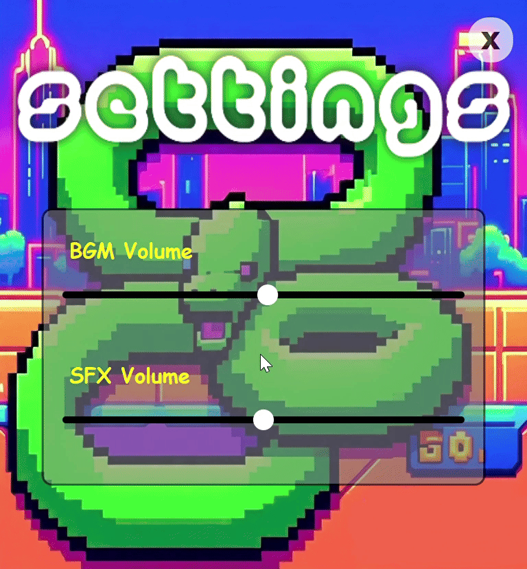
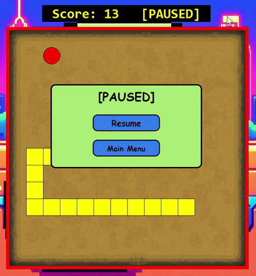

 

---

###### 👨‍💻 Developed By Team Nostalics

---
### Table of contents
[Overview](#-overview-) 
[Gameplay Clip](#-gameplay-preview) 
[How to run](#-how-to-run-snake-nostal-core) 
[Game Features](#-game-features) 
[Profile Feature](#-profile-creation) 
[Custom Game Feature](#-custom-game) 
[Game Objective](#-game-objective) 
[Ambience Sounds](#-ambience-and-sound) 
[Gameplay Info](#-overview-) 
[Mechanics](#-game-mechanics) 
[Controls](#-game-controls) 
[Extra Feature](#-extra-features) 

---

### 🐍 Overview 
**Snake Nostal-Core** is a game inspired from old school arcade retro snake game.  
The main purpose of this game is for **educational and personal skill development**.

##### **⚠️ Disclaimer** 
We do not claim ownership of any images or sounds used in this project.
Most assets were generated using AI, **except for the ground images**.

---

### ▶️ How to run Snake Nostal-Core
1. **🚀 Prebuilt Executable**  A prebuilt executable program named `Snake Nostal-Core.exe` is included that runs the full program.
    - This executable may trigger security warnings because it is unsigned and created using an open-source packaging tool.  
  Obtaining a verified code-signing certificate is cost-prohibitive for a small academic project, so it is not included.  
  We guarantee that the application is free from viruses or malicious software.
    - If the file is not included in the repo, you can download the game here: [Download Snake Nostal Core](https://drive.google.com/file/d/1cKODuj4lpJe8lMBvV8Q5Vr29MVEDGfvv/view?usp=drive_link)

2. **💻 Through Compiler**  By the use any IDE (e.g. **PyCharm** or **VS Code**), open the folder that contains this file and run the file named `MainPage.py`.
    #### 📦 Requirements
   - Make sure you have **PyQt5 and pygame library** before running with compiler
   - In-case you don't have the **PyQt5 and pygame**, you can install them by opening your IDE command terminal and run `pip install PyQt5` and `pip install pygame`.

---

## 🎮 Game Features

---

#### ✍ Profile Creation
Users can create a custom game profile.  

 

Although it only supports **username**, it still adds a personalized touch.

---

#### 🛠️ Custom Game
Players can change the game setup such as: 
- **Field Size** 
  

- **Environment Type** 

---

#### 🎯 Game Objective
- Unlocks an additional **environment types** upon reaching a specific score milestones.  

---

#### 🎵 Ambience and Sound
- A retro-style background music for extra nostalgic atmosphere.
- **BGM** and **SFX** volume intensity can be adjusted in settings. 

---

## 📜 Gameplay Info

---

#### 🎲 Game Mechanics
- Snakes' speed increases every **5 points**
- Speed caps once the score reaches **35**

---

#### 🕹 Game Controls
- Press `<space>` to start the game.
- And **W | A | S | D** or **Up | Down | Left | Right arrow keys** to move in different directions.
- Press `<space>` again to pause or resume the game.

---

#### 🎥 Gameplay Preview

---

---

#### 🎁  Extra Feature(s)
- **💾 Save Data System**
Player data is stored locally, including:

  - High Score
  - Field Size
  - Environment Type
  - Username
  - BGM Volume
  - SFX Volume
---

 [Go to Top](#top)

